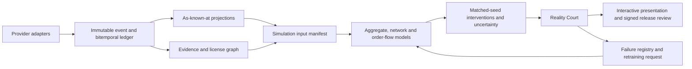

# EPOCH Ω — Product and Systems Architecture

## North star

Build an evidence-grounded, interactive laboratory for scenarios and decisions, not an AI oracle that claims to foresee reality. The ideal end state joins source ingestion, bitemporal history, causal hypothesis management, competitive simulations, uncertainty quantification, adversarial challenge, a motion-rich world interface, and authorized software delivery. The current HTML implements a small but real vertical slice in the first five areas.

## Canonical data plane

### The two clocks

- **Valid/observation time**: when the value refers to the represented world (e.g. the bond yield observed on Nov 20).
- **Transaction/knowledge time**: when our system first captured that value or correction.

Publication time is a third fact and may be materially different. The initial embedded treasury rows were obtained on Nov 23 UTC for earlier observation dates. It would be **look-ahead bias** to treat those Nov 20 values as known before their real release times or as-known-at dataset histories. Production connectors must capture release and revision/vintage information separately from data observation dates.

### Proposed backend contracts (not implemented)

A future append-only database should store: `event_id`, `source_id`, `instrument`, `metric`, `value`, `unit`, `event_valid_from`, `event_valid_to`, `known_from`, `known_to`, `source_event_id`, `source_revision`, `provider_retrieved_at`, `public_release_at`, `payload_sha256`, `license_id`, `connector_version`, `schema_version`, and `supersedes_event_id`.

An event is corrected with a *new* event; the old event stays available for as-known-at replay. Projections may be rebuilt from the log. No release logic should silently replace one provider's price with another's; conflicts are first-class events.

## Simulation science

Model A is aggregate Monte Carlo with hand-chosen sensitivities. Model B is a separate directed network with correlated shocks and nine coupled sectors. Model C is a toy price-time matching engine with order expiration and three configurable stress regimes. **None is trained on actual order-level data or independently validated.** All use deterministic seeds for reproducible local experiments. This is meaningful as a software demonstration but not sufficient for economic validity.

A genuine scientific evolution would add: real data ingestion and vintages, LOB data cleaning and session semantics, calibration by simulation-based inference, parameter posterior ensembles, held-out order flow and return distribution evaluation, intervention consistency against the parent simulator, model cards, prospective forecast tracking, and independent red-team evidence.

## Security and authority

The browser has no real-trading permission or route. Production decisions should separate proposal from authorization and execution. Read-only research runs freely; user-approved changes to databases, code repositories, cloud billing, publication, or trading require distinct scopes. All retrieved evidence and agent outputs are untrusted inputs. Source licenses and derivative-work rights must travel with each transform; neither W3C-PROV nor OpenLineage automatically enforces them.

## Performance and animation

The rendering loops use `requestAnimationFrame` and reduced-motion preferences. They may render at the refresh rate the browser and hardware support; no claim of thousands of actual displayed frames per second is made. For industrial-scale visual simulation, separate worker-based compute from the rendering thread, limit memory, preserve stable frame pacing, and benchmark GPU/CPU paths on the target device.
